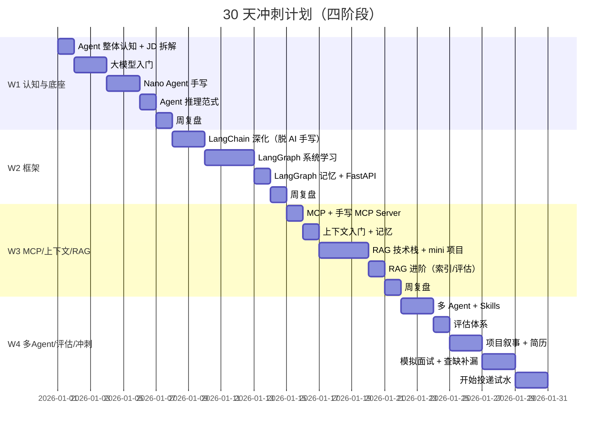

# 一个月转型 Agent 学习计划（30 天冲刺版）

> 依据《社招后端转型 Agent 路径（已落地）》的方法论压缩而来：**JD 拆解定位范围 → MIT 学习法吃透模块 → 甘特图跟踪 → 节点报告复盘 → 里程碑验收**。
> 前提假设：有后端基础（Java/任意语言）、Python 能读能改但手写不熟、每天可投入约 10.5h（全日制节奏）。在职学习可按每天 3-4h 折算为 10 周版。
> 与原计划的取舍：原计划 11 周，压缩到 4 周的核心代价是——大模型进阶、源码精读（Hermes/Claude Code）、AutoGen/CrewAI 等扩展项全部砍掉，只保留面试必考主线。

## 〇、方法论落地规则（全程执行）

原文方法论如何映射到这个计划：

| 原文方法 | 本计划中的落地动作 |
| --- | --- |
| JD 拆解 | Day 1 先投递 5-10 个目标岗位，把 JD 抽成共性要求清单，每周末对照检查覆盖率 |
| MIT 学习法 | 每个模块固定四步：① 权威资料 → ② 让 AI 生成 teach HTML 讲给你 → ③ 有重点回看原文 → ④ 让 AI 反问你 5 个问题，答不上来的记入薄弱清单 |
| 脱 AI 原则 | 学框架/写代码时关掉 AI 补全（Cursor 等），面试时没有 Cursor，学习时也不该有 |
| 甘特图跟踪 | 每晚在本文末尾勾选当日完成项，未完成标红并顺延（最多顺延 1 天，连卡 2 天就砍范围） |
| 节点报告 | 每天 30min 复盘（学到了什么/卡在哪/明天改什么）；每周日 1h 周报（对照里程碑 + 薄弱清单 + JD 覆盖率） |
| 评估思维 | 从 Day 15 起所有产出（RAG 项目、Agent demo）自带量化指标，面试叙事必须带数字 |

## 一、总体甘特图

## 二、每日计划

### W1（Day 1-7）：认知与底座 —— "Agent 怎么动起来的"

| 天 | 白天主题（8h） | 学习资料 | 验收标准 |
| --- | --- | --- | --- |
| Day 1 | ① 投递 5-10 个目标岗位、拆 JD 抽共性清单；② Agent 整体认知：Agent 由什么组成、各模块能力来源 | [ai-agent-book 第一章](https://github.com/bojieli/ai-agent-book/blob/main/book/chapter1.md) | 能画出一张 Agent 架构分层图并讲清每层职责 |
| Day 2 | 大模型入门 I：Transformer 直觉、自回归、Attention | [3B1B Transformers](https://www.youtube.com/watch?v=wjZofJX0v4M)、[3B1B Attention](https://www.youtube.com/watch?v=eMlx5fFNoYc)、[LLM Visualization](https://bbycroft.net/llm) | 能讲清一次 forward 的完整流程 |
| Day 3 | 大模型入门 II：Prefill/Decode、KV Cache、Tokenizer、Embedding；走通一次 Prefill | [3B1B LLM 存事实](https://www.youtube.com/watch?v=9-Jl0dxWQs8)、[Transformer Circuits](https://transformer-circuits.pub/2021/framework/index.html) | 能回答"长上下文为什么贵"（O(n²) + KV Cache 显存） |
| Day 4 | Nano Agent 手写（脱 AI）：~100 行最小 Agent，逐行理解循环、工具调用、消息流转 | [nanoAgent](https://github.com/sanbuphy/nanoAgent)、[Learn Claude Code S01](https://learn.shareai.run/zh/s01/) | 不看源码独立重写；说清"框架帮我吃掉了什么" |
| Day 5 | Nano Agent 进阶：给它加记忆与简单规划，观察上下文怎么膨胀 | 同上 + Anthropic 博客 | 能复述"上下文爆炸"的最小成因 |
| Day 6 | Agent 推理范式：ReAct / Plan-and-Execute / Workflow 三者差异与选型 | [Lilian Weng: LLM Powered Autonomous Agents](https://lilianweng.github.io/posts/2023-06-23-agent/)、[ReAct 论文](https://arxiv.org/abs/2210.03629) | 能回答面试高频题"为什么选 ReAct 不选其他" |
| Day 7 | 周复盘 + 薄弱清单 AI 反问 + 算法集中补弱 | — | 产出周报；JD 覆盖率自查 |

**里程碑①（Day 7）**：能独立手写 Python 最小 Agent + 讲清 Agent 架构分层与大模型推理原理。

### W2（Day 8-14）：框架深度 —— 原文强调"最重要的学习项"

| 天 | 白天主题（8h） | 学习资料 | 验收标准 |
| --- | --- | --- | --- |
| Day 8 | LangChain 深化 I（脱 AI）：创建 Agent、@tool / StructuredTool 定义工具 | [LangChain Docs](https://docs.langchain.com/oss/python/langchain/overview) | 从零写一个带工具调用的 Agent |
| Day 9 | LangChain 深化 II：Memory（Buffer/Summary/Window）、Callback | 同上 | 三种 Memory 说清差异与适用场景 |
| Day 10 | LangGraph I：StateGraph/节点/边/条件路由概念 + 最小 demo | [LangGraph Docs](https://docs.langchain.com/oss/python/langgraph/overview) | 理解"为什么从 LangChain 迁移到 LangGraph" |
| Day 11 | LangGraph II：State / Reducer / Checkpoint / Send 并行 | 同上 + LangSmith | 能解释并发写冲突靠 Reducer 合并 |
| Day 12 | LangGraph III：不看原代码，从零重写一个意图路由工作流（原文关键练习） | 安装 LangChain 官方 Skill | 重写成功 = 真学会了 |
| Day 13 | LangGraph 记忆注入 + FastAPI 核心（依赖注入/中间件/异步，对比 Spring Boot 学） | [LangGraph Memory](https://docs.langchain.com/oss/python/langgraph/add-memory)、[FastAPI](https://fastapi.tiangolo.com/zh/) | 能答"FastAPI 和 Spring Boot 的区别" |
| Day 14 | 周复盘 + 把 W1-W2 的代码整理成 GitHub 可展示的 repo | — | 产出周报 + repo README |

**里程碑②（Day 14）**：能独立写 LangChain Agent + LangGraph 工作流，代码沉淀成可展示仓库。

### W3（Day 15-21）：MCP / 上下文 / RAG —— 面试覆盖面补齐

| 天 | 白天主题（8h） | 学习资料 | 验收标准 |
| --- | --- | --- | --- |
| Day 15 | MCP 原理：JSON-RPC 2.0、stdio transport、tool/resource 规范；**脱 AI 手写一个简单 MCP Server**；思考好工具设计（name/description/arg） | [ai-agent-book 第四章](https://github.com/bojieli/ai-agent-book/blob/main/book/chapter4.md)、[MCP 终极指南](https://guangzhengli.com/blog/zh/model-context-protocol)、[microsoft/mcp-for-beginners](https://github.com/microsoft/mcp-for-beginners/blob/main/translations/zh-CN/README.md) | 独立写通 MCP Server 并被 LangGraph Agent 调用 |
| Day 16 | 上下文入门 + 记忆：上下文为什么重要、各模块信息如何进入上下文；短期/长期/场景记忆，记忆与上下文的关系 | [ai-agent-book 第二章（读到 Skills 前）](https://github.com/bojieli/ai-agent-book/blob/main/book/chapter2.md)、[第三章记忆部分](https://github.com/bojieli/ai-agent-book/blob/main/book/chapter3.md)、[Anthropic: Context Engineering](https://www.anthropic.com/research/effective-context-engineering-for-ai-agents) | 能讲"知识库 vs Memory"的区别与联动 |
| Day 17 | RAG 技术栈 I：文档切分策略、Embedding 选型、Chroma → Milvus | [LlamaIndex Advanced RAG](https://www.llamaindex.ai/blog/a-cheat-sheet-and-some-recipes-for-building-advanced-rag-803a9d94c41b)、[All-in-RAG](https://datawhalechina.github.io/all-in-rag/#/chapter1/01_RAG_intro) | 开始 mini RAG 项目：选一个业务域文档入库 |
| Day 18 | RAG 技术栈 II：检索策略（Dense/BM25/混合/RRF/Rerank），在项目里逐个实验并记录指标 | [Lilian Weng](https://lilianweng.github.io/posts/2023-06-23-agent/#maximum-inner-product-search-mips)、[HNSW \| Pinecone](https://www.pinecone.io/learn/series/faiss/hnsw/) | 项目报告：每种策略的 Recall@K 对比数字 |
| Day 19 | RAG 技术栈 III：RAG Pipeline 串联 + 三层评估体系（检索评测/答案评测/线上） | [Anthropic: Demystifying Evals](https://www.anthropic.com/research/demystifying-evals-for-ai-agents) | 项目自带 Golden Set 与量化指标 |
| Day 20 | RAG 进阶：索引选型（FLAT/HNSW/IVF/IVF-PQ）、向量库选型、幻觉抑制 | [HNSW](https://www.pinecone.io/learn/series/faiss/hnsw/)、[Milvus IVF](https://milvus.io/docs/zh/ivf-flat.md)、[Milvus IVF-PQ](https://milvus.io/docs/zh/ivf-pq.md) | 能答"为什么选 HNSW""Top5 命中但答案错怎么办" |
| Day 21 | 周复盘 + RAG 项目收尾成文（README + 指标表） | — | 产出周报 + 可写进简历的项目描述 |

**里程碑③（Day 21）**：RAG + MCP + 上下文全链路掌握，mini 项目带指标；**此时可以小范围投递练手**。

### W4（Day 22-30）：差异化 + 评估 + 面试冲刺

| 天 | 白天主题（8h） | 学习资料 | 验收标准 |
| --- | --- | --- | --- |
| Day 22 | 多 Agent 设计模式：通信策略、任务分配、主子 Agent 协作 | [LangChain Multi-agent](https://docs.langchain.com/oss/python/langchain/multi-agent/index)、[Anthropic: Multi-Agent Systems](https://claude.com/blog/building-multi-agent-systems-when-and-how-to-use-them) | 能讲"单 Agent 拆多 Agent 解决什么、带来什么代价" |
| Day 23 | Skills 体系：定义、原理、触发加载机制 | [Deep Agents 实战第 7 章](https://datawhalechina.github.io/deepagents-in-action/chapters/ch07-skills/)、[Agent Skills Overview](https://agentskills.io/home) | 能设计一个 Skill 的文件结构与触发规则 |
| Day 24 | 评估体系深练：原文警告"评估讲不好基本就挂"——三层体系 + 指标定义 + Bad Case 归因 | [Anthropic Evals](https://www.anthropic.com/research/demystifying-evals-for-ai-agents) | 每个 demo 项目都能报出 3 个以上量化指标及口径 |
| Day 25 | 项目叙事打磨：每个项目按 STAR 展开，拆亮点/难点，全部带数字量化（怎么统计、什么口径） | — | 简历项目段定稿 |
| Day 26 | 简历优化：重点技术栈罗列命中机筛关键词；**保留后端经历**（原文踩坑：只写 AI 项目会被 HR 筛掉） | — | 简历终稿 |
| Day 27 | 模拟面试 I：把 [面试问题分类与参考答案.md](./面试问题分类与参考答案.md) 当题库，AI 逐类反问（RAG/Agent 架构/上下文/工具） | 同目录面经文件 | 薄弱清单更新 |
| Day 28 | 模拟面试 II：场景题专项（工具设计/上下文压缩/评估落地）+ HR 题口径统一（离职原因/转型动机/薪资） | 同上 | 每类题能脱稿讲 3 分钟 |
| Day 29 | 开始小范围投递试水（优先非目标城市/非目标公司练手，一天最多 3 场） | — | 每场面试后当天复盘 |
| Day 30 | 复盘调优 + 查缺补漏 + 全面投递 | — | 一个月总结报告 |

**里程碑④（Day 30）**：技术主线全覆盖 + 面试叙事成型 + 进入投递循环。

## 三、算法刷题（全程并行 · 每晚 1.5h）

每天 2 题，Python 编写（一石二鸟：练算法 + 练 Python 手感）。30 天目标约 55 题，聚焦 Hot 100 核心：

| 阶段 | 天数 | 题型重点 | 关键题型 |
| --- | --- | --- | --- |
| W1 | Day 1-7 | 数组、哈希、字符串、双指针 | 两数之和、三数之和、无重复最长子串、字母异位词 |
| W2 | Day 8-14 | 二叉树、链表、栈/队列 | 层序遍历、反转链表、有效括号、LRU |
| W3-W4 | Day 15-30 | BFS/DFS、DP 基础、高频原题 | 岛屿数量、爬楼梯、二分变种、Hot 100 收尾 |

资源：[LeetCode Hot 100](https://leetcode.cn/studyplan/top-100-liked/)、[代码随想录](https://programmercarl.com/)。

## 四、每日节奏模板（全日制 · 约 10.5h）

| 时间段 | 安排 |
| --- | --- |
| 09:00 - 09:20 | 三层递进法：昨天的心智模型 / 与其他方案的分歧点 / 深度自测 |
| 09:20 - 12:00 | 当日核心学习（资料 + 代码实践，关 AI 补全） |
| 12:00 - 13:30 | 午休 + 碎片化阅读 |
| 13:30 - 17:30 | 项目实践 / 代码练习（验收标准导向） |
| 17:30 - 18:30 | 复盘总结 + 笔记 + AI 反问 |
| 19:30 - 21:00 | 算法 2 题（Python） |
| 周六、周日 | 不在计划内的休息日按需补进度（本计划 30 天连续，若插入休息日整体顺延） |

> 每日复盘三问（写进笔记）：今天学到的最重要的一个心智模型是什么？哪里和我的既有认知冲突？AI 反问中答不上来的是什么？

## 五、风险与取舍（压缩到 30 天必须知道的）

1. **砍掉了什么**：大模型进阶（mlabonne llm-course）、AutoGen/CrewAI、源码精读、前沿论文跟进。面试问到就诚实说"了解概念、未深入实践"，比编造安全。
2. **压缩最大风险**：LangGraph（原计划 10 工作日 → 4 天）和 RAG（原计划 10 工作日 → 5 天）时间腰斩。对策：验收标准不降级——重写意图路由、RAG 指标对比表这两件事不可省，宁可砍算法题量。
3. **投递节奏不同**：原文 75% 准备度即开始面试。30 天版在 Day 21（约 70%）先投练手、Day 29 起正式投递，用真实面试暴露短板、Day 30 后进入"边面边补"循环。
4. **薄弱清单优先级**（原文血泪教训）：评估体系 > RAG 索引选型 > 记忆/Skills > 范式选型。评估讲不好基本就挂，时间不够优先保它。

## 六、资源速查（按学习顺序）

| 模块 | 主资料 | 辅助 |
| --- | --- | --- |
| Agent 整体认知 | [ai-agent-book ch1](https://github.com/bojieli/ai-agent-book/blob/main/book/chapter1.md) | [Learn Claude Code](https://learn.shareai.run/zh/s01/) |
| 大模型入门 | 3B1B Deep Learning ch5-7 | [LLM Visualization](https://bbycroft.net/llm) |
| Nano Agent | [sanbuphy/nanoAgent](https://github.com/sanbuphy/nanoAgent) | — |
| 推理范式 | [Lilian Weng](https://lilianweng.github.io/posts/2023-06-23-agent/) | [ReAct 论文](https://arxiv.org/abs/2210.03629) |
| MCP | [ai-agent-book ch4](https://github.com/bojieli/ai-agent-book/blob/main/book/chapter4.md) | [MCP 终极指南](https://guangzhengli.com/blog/zh/model-context-protocol)、[mcp-for-beginners](https://github.com/microsoft/mcp-for-beginners/blob/main/translations/zh-CN/README.md) |
| 上下文/记忆 | [ai-agent-book ch2/ch3](https://github.com/bojieli/ai-agent-book/blob/main/book/chapter2.md) | [Anthropic Context Engineering](https://www.anthropic.com/research/effective-context-engineering-for-ai-agents) |
| LangChain/LangGraph | [LangChain Docs](https://docs.langchain.com/oss/python/langchain/overview) / [LangGraph Docs](https://docs.langchain.com/oss/python/langgraph/overview) | [LangGraph Memory](https://docs.langchain.com/oss/python/langgraph/add-memory) |
| RAG | [All-in-RAG](https://datawhalechina.github.io/all-in-rag/#/chapter1/01_RAG_intro)、[Advanced RAG Cheat Sheet](https://www.llamaindex.ai/blog/a-cheat-sheet-and-some-recipes-for-building-advanced-rag-803a9d94c41b) | [HNSW](https://www.pinecone.io/learn/series/faiss/hnsw/)、[Milvus 索引](https://milvus.io/docs/zh/ivf-flat.md) |
| Skills | [Deep Agents ch7](https://datawhalechina.github.io/deepagents-in-action/chapters/ch07-skills/) | [agentskills.io](https://agentskills.io/home) |
| 多 Agent | [LangChain Multi-agent](https://docs.langchain.com/oss/python/langchain/multi-agent/index) | [Anthropic Multi-Agent 博客](https://claude.com/blog/building-multi-agent-systems-when-and-how-to-use-them) |
| 评估 | [Anthropic: Demystifying Evals](https://www.anthropic.com/research/demystifying-evals-for-ai-agents) | 同目录《面试问题分类与参考答案.md》评测章节 |
| 综合参考书 | [《深入理解 AI Agent》李博杰](https://github.com/bojieli/ai-agent-book)（贯穿全程，卡壳时翻对应章节） | — |
